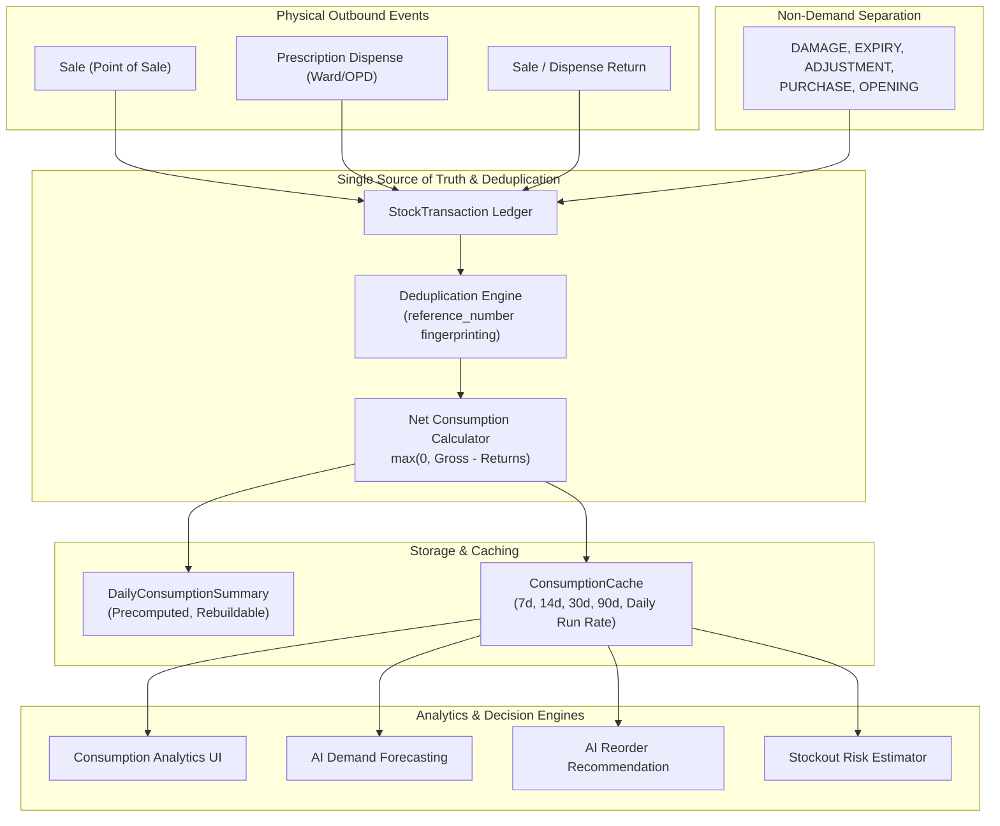

# MediVault — Consumption Analytics Engine Architecture

## 1. Architectural Overview

MediVault's Consumption Analytics module calculates real medicine velocity and demand trends directly from committed, verified physical inventory transactions. It ensures that stock metrics displayed on dashboards and fed into forecasting models reflect actual clinical consumption rather than raw sales counts or non-consumption inventory adjustments.

---

## 2. Single Source of Truth & Transaction Ledger

The physical movement of medicines is recorded atomically in the `inventory.StockTransaction` ledger:
- **`SALE`**: Counter sales to patients or customers.
- **`DISPENSE`**: Prescription dispensing issued to hospital departments, wards, or inpatients.
- **`RETURN`**: Unused, returned, or cancelled medicine returned to active stock.
- **`PURCHASE` / `OPENING`**: Inbound stock receipts (excluded from consumption).
- **`DAMAGE` / `EXPIRY` / `ADJUSTMENT`**: Physical shrinkage or administrative stock corrections (strictly excluded from clinical demand).
- **`HISTORICAL_IMPORT`**: Past historical consumption records imported for AI model calibration; stored without altering current physical batch balances.

---

## 3. Deduplication and Reversal Invariants

### 3.1 Deduplication
In hospital pharmacy workflows, a dispensation event and a billing sale transaction may refer to the same physical issue of medicine (e.g. linked via a prescription number or invoice reference).
- The consumption engine tracks seen `reference_number` strings within each evaluation time window.
- Dispensations (`DISPENSE`) are evaluated first, adding their normalized reference tokens to the deduplication registry.
- Subsequent sales (`SALE`) sharing the identical reference token are treated as the same physical event and counted exactly once.

### 3.2 Returns & Cancellations
- Returns are subtracted from gross consumption:
  $$\text{Net Consumption} = \max(0, \text{Gross Consumption} - \text{Return Quantity})$$
- Returns exceeding gross consumption within the window are bounded at zero and never yield negative consumption.
- Cancelled sales are queried from `sales.Sale` (status `CANCELLED`) and completely excluded from outbound calculations.

---

## 4. Multi-Period & Velocity Calculations

All calculations utilize `analytics.date_service.resolve_date_range` for dynamic timezone-aware window boundaries:
- **Today**: Current date from 00:00:00 to current timestamp.
- **Rolling 7-Day**: Last 7 complete days ($\text{today} - 6\text{d} \dots \text{today}$).
- **Rolling 14-Day**: Last 14 complete days.
- **Rolling 30-Day**: Standard operational planning window.
- **Rolling 90-Day**: Strategic trend and quarterly planning window.
- **Month-to-Date (MTD)**: 1st of the current calendar month to today.
- **Last Month**: Previous calendar month (complete).
- **Quarter-to-Date**: Dynamic start of current quarter to today.

### Daily Run Rate Formula
$$\text{Daily Run Rate} = \frac{\text{Net Units Consumed in Window}}{\text{Days in Window}}$$

---

## 5. Stockout Suppression Detection

When a medicine experiences a stockout ($\text{stock} = 0$), observed sales drop to zero regardless of patient demand:
- The engine identifies whether `Inventory.current_stock == 0` or any `StockTransaction` recorded `new_stock == 0` during the window.
- Affected analytics records are flagged with `stockout_suppressed = True` along with a clinical warning notice:
  > *"Observed consumption may underestimate true clinical demand due to zero-stock conditions during the period."*

---

## 6. Precomputed Summary & Performance Caching

1. **`DailyConsumptionSummary` Model**:
   - Stores `sale_qty`, `dispense_qty`, `return_qty`, `net_consumption`, and `transaction_count` per `(medicine, date)`.
   - Idempotent: `unique_together = [['medicine', 'date']]`.
   - Completely rebuildable from transactions via `rebuild_daily_summary(medicine, date_from, date_to)`.
   - Never alters physical stock.

2. **`ConsumptionCache` Model**:
   - One-to-one per active medicine.
   - Caches precalculated `consumed_7d`, `consumed_14d`, `consumed_30d`, `consumed_90d`, `daily_avg_30d`, and `data_quality`.
   - Updated synchronously on transactions and historical imports.

---

## 7. Data Quality & Confidence Scoring

Data quality reflects the transaction density available for demand estimation:
- **`GOOD`**: $\ge 15$ consumption transactions in the past 90 days.
- **`WARNING`**: $5 \text{ to } 14$ consumption transactions.
- **`INSUFFICIENT_DATA`**: $< 5$ consumption transactions. Triggers Cold-Start safety fallback in AI engines.
