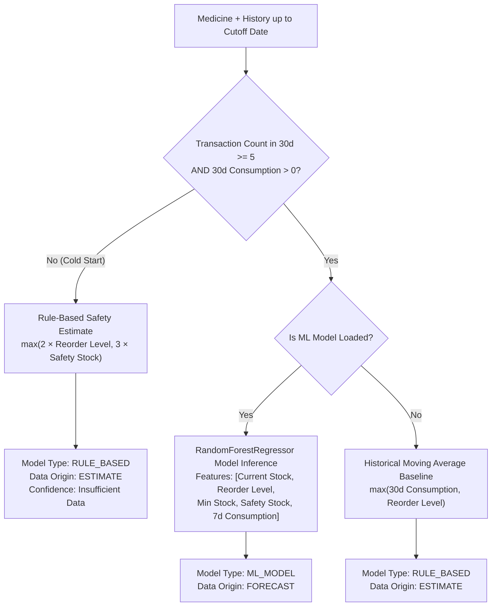

# MediVault — AI Demand Forecasting & Reorder Intelligence

## 1. Overview

MediVault's AI Demand Forecasting engine (`ai_engine.intelligence_service`) predicts multi-horizon medicine requirements and calculates explainable replenishment quantities. The engine combines machine learning models with rule-based safety buffers, accounts for clinical criticality (VED), and incorporates open procurement commitments to prevent duplicate ordering.

---

## 2. Multi-Horizon Forecasting Engine

The engine provides forecasts across five operational horizons:
- **7-Day Forecast**: Urgent scheduling and high-velocity ward stock replenish.
- **14-Day Forecast**: Bi-weekly stock balancing and fast-moving medicine checks.
- **30-Day Forecast**: Standard monthly procurement planning base.
- **60-Day Forecast**: Intermediate vendor contracting horizon.
- **90-Day Forecast**: Strategic procurement and seasonal inventory reserve planning.

### Time-Cutoff & Zero Data Leakage
All forecast functions accept a `cutoff_date` parameter. Historical consumption and transaction features strictly exclude records created after `cutoff_date`, enabling leak-free backtesting and time-split validation.

---

## 3. Forecasting Models & Fallback Architecture

### 3.1 Machine Learning Model
- **Algorithm**: `RandomForestRegressor` trained on historical pharmacy consumption patterns.
- **Artifact Path**: `ml/models/demand_forecast_model.joblib`.
- **Feature Vector**:
  $$\mathbf{x} = [\text{current\_stock}, \text{reorder\_level}, \text{minimum\_stock}, \text{safety\_stock}, \text{consumed\_7d}]$$

### 3.2 Cold-Start Fallback
When a new medicine has fewer than 5 consumption transactions:
$$\text{Forecast}_{30\text{d}} = \max(2 \times \text{reorder\_level}, 3 \times \text{safety\_stock})$$
Ensures critical medicines never go unstocked due to absence of initial transaction volume.

---

## 4. Reorder Recommendation Engine

Recommendations are generated via `get_reorder_recommendations()`, factoring in physical stock, open purchase orders, supplier lead time, and safety buffers.

### 4.1 Open PO Awareness (Anti-Duplication)
Only approved/ordered commitments represent valid inbound stock:
- Open statuses: `('APPROVED', 'ORDERED', 'PARTIAL_RECEIPT')`.
- Drafts, pending review, and cancelled POs are excluded.
$$\text{Effective Available Stock} = \text{Usable Stock} + \text{Open PO Quantity}$$

### 4.2 Reorder Formula
A reorder recommendation is triggered if:
$$\text{Effective Available} \le \text{Reorder Level} \quad \lor \quad (\text{Effective Available} - \text{Forecast}_{30\text{d}}) < \text{Safety Stock}$$

The recommended order quantity is:
$$\text{Net Shortfall} = \text{Forecast}_{30\text{d}} + \text{Safety Stock} - \text{Effective Available}$$
$$\text{Remaining Capacity} = \max(0, \text{Maximum Stock} - \text{Effective Available})$$
$$\text{Recommended Quantity} = \min(\text{Remaining Capacity}, \max(0, \text{Net Shortfall}))$$

---

## 5. Stockout Risk & Run-Out Date Estimation

The `get_stockout_risk()` function continuously evaluates inventory vulnerability:
- **Daily Rate ($D$)**: Average daily consumption from the 30-day window (or 7-day if 30-day is sparse).
- **Days Until Stockout**:
  $$\text{Days to Stockout} = \left\lfloor \frac{\text{Effective Stock}}{D} \right\rfloor$$
- **Estimated Stockout Date**:
  $$\text{Date} = \text{today} + \text{Days to Stockout}$$

### Risk Tiers
| Tier | Condition | Action |
| :--- | :--- | :--- |
| **`CRITICAL`** | Usable Stock = 0 OR Days to Stockout $\le$ Supplier Lead Time | Emergency PO creation; immediate administrative alert |
| **`HIGH`** | Days to Stockout $\le 2 \times$ Supplier Lead Time | Reorder recommended within regular procurement cycle |
| **`MEDIUM`** | Stock $\le$ Reorder Level | Monitor; include in batch weekly order |
| **`LOW`** | Stock levels exceed projected lead-time consumption | No procurement action needed |
| **`NO_DATA`** | No consumption transactions recorded | Cold-start buffers active |

---

## 6. VED Criticality Integration

Every reorder recommendation includes Vital, Essential, Desirable (VED) classification:
- **`V` (Vital)**: Schedule X, Narcotics, resuscitation drugs. Stockout carries life-threatening consequences.
- **`E` (Essential)**: Schedule H, Schedule H1, standard prescription antibiotics and chronic maintenance drugs.
- **`D` (Desirable)**: OTC items, vitamins, non-critical consumables.
