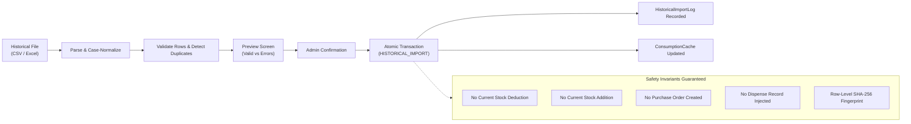

# MediVault — Historical Consumption Import Engine

## 1. Overview & Purpose

The Historical Consumption Import Engine (`inventory.historical_import`) enables hospital pharmacy administrators to bootstrap or recalibrate the AI Demand Forecasting engine by importing historical sales and dispensing data from CSV or Excel (`.xlsx`, `.xls`) files.

---

## 2. Invariants & Safety Guarantees

### Critical Rules Enforced:
1. **Zero Stock Mutation**:
   `previous_stock == new_stock == Inventory.current_stock`.
   Current physical inventory and batch balances are untouched.
2. **Audit Separation**:
   Imported records are tagged with `transaction_type = 'HISTORICAL_IMPORT'` to distinguish historical calibration data from live transactions.
3. **No Phantom Commercial Documents**:
   Does not generate artificial purchase receipts, invoices, or dispensing bills.
4. **Idempotence & Fingerprinting**:
   Each row is assigned a deterministic SHA-256 fingerprint:
   $$\text{Fingerprint} = \text{SHA256}(\text{medicine\_id} \mid \text{txn\_date} \mid \text{quantity} \mid \text{reference})[:32]$$
   Re-importing the same file or identical row detects existing fingerprints in `StockTransaction.reference_number` and skips them safely.
5. **No Future Dates**:
   All row dates must be $\le \text{today}$. Future dates are rejected during validation.

---

## 3. Supported File Formats & Column Mapping

The parser supports UTF-8, UTF-8-BOM, Latin-1 CSV files and OpenPyXL-compatible `.xlsx` / `.xls` spreadsheets.

| Header (Aliases Accepted) | Mandatory | Example | Description |
| :--- | :--- | :--- | :--- |
| `medicine` (`medicine_name`, `medicine_id`, `barcode`) | **Yes** | Amoxicillin 500mg | Matched against database by ID, name (case-insensitive), or barcode |
| `quantity` (`qty`, `units`, `consumed`) | **Yes** | 45 | Positive integer units consumed |
| `date` (`consumption_date`, `transaction_date`) | Optional | 2025-11-20 | Defaults to current date if omitted. Formats: YYYY-MM-DD, DD-MM-YYYY, DD/MM/YYYY |
| `reference` | Optional | HIST-2025-01 | Reference identifier used in fingerprinting |
| `notes` | Optional | Legacy HIS Data | Context notes recorded in transaction |

---

## 4. Provenance & Import Audit Trail

Every import execution is tracked in the `HistoricalImportLog` model:
- **`uploaded_by`**: Foreign key to the authenticated administrator.
- **`filename`**: Source file name.
- **`uploaded_at`**: Timestamp of upload.
- **`status`**: `PENDING`, `COMPLETED`, `FAILED`, `PARTIAL`.
- **`total_rows`**, **`valid_rows`**, **`error_rows`**, **`imported_rows`**.
- **`import_batch_ref`**: SHA-256 fingerprint of the import session.
- **`row_errors`**: JSON array of line-by-line validation errors for administrator inspection.

---

## 5. Administrative UI Workflow

1. Navigate to **Inventory → Consumption Analytics → Import Historical Data** (Admin only).
2. Upload file via the secure drag-and-drop / file selector.
3. Review the **Validation Results Table**:
   - Total rows, valid rows, invalid rows, and skipped duplicates.
   - Line-by-line error messages for malformed rows.
4. Inspect the first 25 preview records.
5. Click **Confirm & Import** to commit the records atomically.
6. System refreshes `ConsumptionCache` and redirects to the updated analytics view with a success banner.
